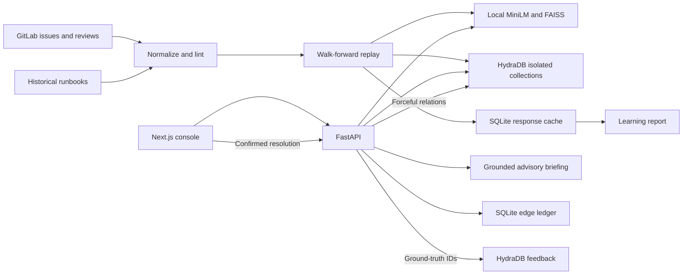

# Precedent

Track 1 · On-call incident memory

Precedent compares a new alert with past incidents, explains useful connections and records which precedents helped at resolution.

## Pre-registered success criteria

These criteria apply to the live GitLab walk-forward replay and were recorded before running any full replay.

1. Over the last three batches, D exceeds C+ on reachable nDCG@5, with the paired bootstrap 95% CI above zero.
2. D exceeds A on hard-subset nDCG@5 over the same batches.
3. On the full reachable subset, D trails A by at most the paired CI half-width.
4. D matches A at a lower context token budget or exceeds A at the same budget.

Live outcomes are pending. Synthetic results exercise the harness and cannot establish these claims.

For a walkthrough of retrieval, the constellation, and engine status, see the [project guide](docs/PROJECT.md).

## Run locally

Requires Python 3.11 and Node 20.9 or later.

```sh
make setup
make api   # terminal 1
make web   # terminal 2
```

Open [the homepage](http://localhost:3000) or go directly to [incident analysis](http://localhost:3000/analysis). The homepage constellation compares nearest text matches with a confirmed graph relationship. The workspace reports whether live configuration is present. The first gateway sample is bundled. To see learning, select **Learning demo · CI workers**, analyze, record the capacity resolution, confirm **INC-039**, and analyze again. The new path runs through **INC-064** to **INC-039**. The other two synthetic triples cover configuration and dependency incidents.

Recorded mode keeps the live HydraDB account untouched. Bundled samples, graph inspection, replay results and scripted confirmations also work with a static export. Custom alert analysis and arbitrary resolutions require FastAPI.

Try the [recorded web demo](https://23-prabhat.github.io/Precedent/) or run the local API to analyze new alert text against the bundled synthetic history.

```sh
make eval              # regenerate the bundled report from the SQLite response cache
make eval-fixture      # rerun the synthetic walk-forward experiment
make check             # unit and endpoint tests, then the Next.js production build
PRECEDENT_STATIC_DEMO=1 make build  # serve web/out/ with any static host
```

## How Precedent earns its place over a vector store

A vector index ranks records by the similarity of their text. Two incidents can describe different failures yet share a fix. When a responder confirms a useful precedent, Precedent writes a relationship from the resolution to the earlier incident. A later alert can retrieve the nearer symptom match and traverse its relationship to surface the earlier incident with the reason attached. The experiment tests this mechanism against an equal-history vector baseline, HydraDB retrieval, automatic graph retrieval and declared structure. Precedent adds outcome-driven writeback and chronological evaluation to the topology demonstrated in HydraDB’s company-brain tutorial.

## Architecture



| HydraDB capability | Use in Precedent |
| --- | --- |
| Collections | Keep plain, declared and learned documents isolated during replay. |
| Fast and thinking query modes | Compare flat retrieval with graph context at fixed query settings. |
| Forceful relations | Persist links to confirmed precedents and indexed fixes. |
| Bring your own graph | Declare cause, service, fix, review and same-fix predicates when S8 passes. |
| Graph sources and paths | Trace returned evidence and inspect neighborhoods. |
| Metadata schema and filters | Keep comparable incident metadata and test filtered retrieval. |
| Feedback | Report returned source IDs as ground truth after evaluation, using the upstream request ID. |

## Evaluate public GitLab history

```sh
cp .env.example .env
make setup-eval
make inspect
make data
make mine
make spikes
make seed
make eval-live
make eval-cache
make eval-live ARGS='--policy manual_link --output data/out/results-manual.json'
```

Set `HYDRADB_API_KEY` and the verified contract in `.env`. Separate databases are used when S9 fails or when `HYDRA_SEPARATE_DATABASES=1`. The public scrape supports an optional `GITLAB_TOKEN` with read access. An LLM token enables optional symptom extraction via `make data ARGS=--llm-fallback` and advisory briefings. Review `data/out/leak-lint.csv` before making claims. The harness conservatively excludes every flagged primary query. A sample of 30 records exposed retrospective cause and workaround phrasing, so the audit also checks those patterns. `make eval-live ARGS='--baseline-only'` runs MiniLM/FAISS and controls without HydraDB. The `Q` and intentionally leaky `L` title variants are separately runnable via `ARGS='--variant Q'` and `ARGS='--variant L'`.

The replay reserves the oldest 20% for seed history and calibration. It queries each later batch before writes, holds incident bodies and reviews until their resolution timestamps precede the next batch, and keeps equal-created-time records in the same partition. A runbook snapshot dated before the first test avoids evaluating past alerts against current documentation. Primary queries use Customer Impact and affected services. Same-tracker future links and repeated template links are scrubbed. Relevance is binary when fewer than 30% of labeled eligible incidents have specific fix references. Raw envelopes, a dataset hash and query measurements are cached in SQLite. The report shows the reachable ceiling, nDCG@5, hard items, cross-service hits, context tokens, latency and paired bootstrap intervals.

## Real-data spikes

The first 50 issues returned were 2018 incidents and had no root-cause labels. The first 500 had none. The full public inventory returned 5,002 incidents with 2,308 unambiguously labeled. The first 500 issues from 2023 yielded 361 labels and 147 eligible symptom queries under the initial parser and leak filter. The local replay uses the newer 2,000-issue snapshot, seven public review bodies and 463 runbooks from commit `a54ef6c32602d954140d047f25346945334240f8`. Removing hidden template comments and excluding causal or remediation language reduced primary-query coverage. S4 did not meet the several-hundred-query target under these controls.

| Spike | Outcome |
| --- | --- |
| S0 · Contract and quotas | SDK 2.1.7 installed and inspected. Hosted account and quotas pending. |
| S1 · Relation direction | Hosted test pending. Reverse ledger traversal verified locally. |
| S2 · Response shape | SDK types inspected and parser tested with response fixtures. Hosted sample pending. |
| S3 · Throughput | Hosted batch size and indexing latency pending. |
| S4 · Public data | Old templates lacked labels. Recent-era sampling and full inventory verified. See later dataset notes. |
| S5 · Graph context | Hosted query coverage pending. |
| S6 · Filters | Hosted exact-match behavior pending. |
| S7 · Latency | Hosted arm timings pending. |
| S8 · Typed edges | BYOG schema verified against [HydraDB documentation](https://docs.hydradb.com/essentials/v2/bring-your-own-graph). Hosted path visibility pending. |
| S9 · Collection isolation | Hosted isolation pending. |

## Results and limitations

The audited GitLab run used 96 primary queries, with 19 in the seed and 77 scored across six batches. Of the scored alerts, 66 were reachable. The seed runbooks and resolved incident history were shared by all arms.

| GitLab arm | Reachable nDCG@5 |
| --- | ---: |
| MiniLM / FAISS | 0.178 |
| Random | 0.046 |
| Label prior | 0.197 |

The label prior beat MiniLM on this cohort. The hard subset contained one reachable alert and is too small for a useful comparison. The [baseline report](docs/gitlab-baseline.json) records every batch, the model revision, snapshot hash and latency. In the console, turn off **Recorded results** and open **Replay report** to see the real baseline. Reproduce its aggregate report with `make eval-cache ARGS='--baseline-only --run-id gitlab-minilm-audited'` after running the baseline under that ID.

The bundled [learning report](web/public/results.json) and [SQLite cache](data/recorded-replay.sqlite) use a synthetic corpus and a sparse lexical vector fixture. Its late batches contain recurring symptom families and can saturate the score. Treat the curve and bootstrap intervals as reproducibility checks. The live GitLab comparisons and Track 1 criteria require a hosted run.

The harness exports up to 20 paired gains and 20 regressions. In the 80-alert synthetic run, vector scored 0.842, assisted Precedent 0.859 and manual-link Precedent 0.862 on reachable nDCG@5. Assisted D minus C+ over the final three batches was −0.004, with a 95% CI of [−0.011, 0.000]. The assisted run yielded nine gains and two regressions versus vector. Linked capacity cases improved the analytics timeout example. In the certificate-chain example, early dependency expansions pushed a same-cause configuration precedent beyond rank five. A live win/loss interpretation is pending. Root-cause labels are coarse and label agreement does not establish that a fix transfers. Public tracker edits can be retrospective and the corpus does not reconstruct every edit as of the alert timestamp. Feedback is best effort and separate from persisted outcome edges. Private deployment requires a trusted access boundary around the API.

## Deployment and submission

Use `make build` and `npm --prefix web start` for a Next.js server. Set `PRECEDENT_API_URL` in its environment before building. Run FastAPI with `uvicorn api.main:app --host 0.0.0.0 --port 8000` on the backend host, set `WEB_ORIGIN` to the frontend origin, and mount `PRECEDENT_STATE_DIR` on persistent storage. Use `/api/health` to warm the backend. The API defaults to recorded mode when requested by the client.

The Release check workflow runs the API and production build tests, reruns the synthetic replay, and uploads `precedent-recorded-demo` for static hosting. Its Pages job publishes the export when Pages uses GitHub Actions. To preview an export hosted below a path, build with `PRECEDENT_STATIC_DEMO=1 PRECEDENT_BASE_PATH=/Precedent make build` and mount `web/out/` at `/Precedent/`.

For another team's incident history, export one JSON object per line into `data/out/manifest.jsonl`. Use a stable `id`, `title`, and `full_text`; include `symptom_text`, service names, and incident timestamps. Runbooks use `doc_type: "runbook"`. For a replay, supply a confirmed `root_cause` and `closed_at` for evaluated incidents and keep symptom text limited to what the responder saw at alert time. Keep the manifest out of Git. Run `make setup-eval`, `make spikes`, and `make seed` with your account configuration, then restart the API before inspecting results from the new corpus.

See the [recorded walkthrough](docs/demo.mp4), [demo script](docs/demo-script.md), [pilot plan](docs/go-to-market.md) and [submission checklist](docs/submission.md).

## Data attribution

Source data is from [GitLab's public production incident tracker](https://gitlab.com/gitlab-com/gl-infra/production/-/issues) and [GitLab's public SRE runbooks](https://gitlab.com/gitlab-com/runbooks). Source terms apply. The repository distributes scripts and synthesized product recordings. GitLab raw issue bodies, historical runbooks, linked reviews and full text remain in the ignored local cache.
